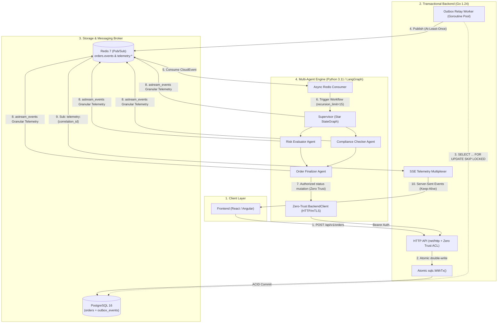

# Hybrid Transactional Platform & Distributed Multi-Agent Engine (EDA)

[](file:///.github/workflows/ci.yml)
[](file:///backend/go.mod)
[](file:///agent-engine/pyproject.toml)
[](file:///docs/adr/0001-hybrid-multiagent-outbox-architecture.md)
[](file:///backend/internal/middleware/auth.go)

Enterprise-grade, distributed Event-Driven Architecture (EDA) platform that decouples high-throughput, deterministic transactional workflows (Golang + PostgreSQL) from probabilistic, iterative multi-agent Artificial Intelligence workflows (Python + LangGraph). The system guarantees ACID consistency, At-Least-Once delivery, real-time granular telemetry via Server-Sent Events (SSE), and a Zero Trust security boundary.

---

## 🏛️ Architectural Topology



---

## 🎯 The 5 Core Architectural Pillars

### 1. Persistence Decoupling & Transactional Outbox Pattern
- **Elimination of Dual-Write Inconsistencies:** Business entity persistence in `orders` and event registration in `outbox_events` are executed within the **same ACID PostgreSQL transaction** via [`sqlc.WithTx()`](file:///backend/internal/service/order_service.go).
- **Lock-Free Asynchronous Polling:** The [`RelayWorker`](file:///backend/internal/worker/relay_worker.go) fetches unprocessed records using `SELECT ... FOR UPDATE SKIP LOCKED` backed by the high-performance partial index `idx_outbox_events_pending_polling`, ensuring multiple horizontal worker replicas in AWS EKS never contend for the same event locks.
- **Thread-Safe Concurrent At-Least-Once Delivery:** Concurrently publishes to Redis Pub/Sub using a buffered worker semaphore pool while applying status updates (`PUBLISHED`/`FAILED`) sequentially and atomically on the database transaction.
- **Graceful Shutdown:** Context-driven lifecycle management adhering to `SIGTERM` and `SIGINT` kernel signals.

### 2. Multi-Agent Engine with Star Topology (LangGraph)
- **Central Supervisor Orchestrator:** The [`SupervisorGraph`](file:///agent-engine/src/graph/supervisor.py) directs transitions toward specialist agents: [`risk_evaluator`](file:///agent-engine/src/graph/nodes.py), [`compliance_checker`](file:///agent-engine/src/graph/nodes.py), and [`order_finalizer`](file:///agent-engine/src/graph/nodes.py).
- **Structured Output Routing:** Next-node transitions are strictly enforced through typed Pydantic models ([`RouterDecision`](file:///agent-engine/src/state/agent_state.py)), with a deterministic heuristic fallback for resilient offline/degraded operation.
- **Immutable Append-Only State:** The global [`AgentState`](file:///agent-engine/src/state/agent_state.py) enforces non-destructive reducer operators (`add_messages`, `operator.add`) for immutable forensic auditability.
- **Guaranteed Token Safeguard:** All graph invocations enforce an explicit `recursion_limit=15` preventing infinite execution cycles.

### 3. Real-Time Telemetry Streaming (SSE + Redis)
- **Reactive Streaming via `astream_events`:** The Python engine taps into LangGraph's lifecycle events (`on_chain_start`, `on_chat_model_stream`, `on_tool_start`) and pipes real-time updates to Redis Pub/Sub on `telemetry:{correlation_id}` channels.
- **Go SSE Multiplexer:** The [`SSETelemetryHandler`](file:///backend/internal/handler/sse_handler.go) asynchronously multiplexes Redis streams into a persistent `text/event-stream` for frontend clients.
- **Keep-Alive & Memory Leak Prevention:** Implements a 15-second heartbeat ticker emitting `: ping\n\n` comments to bypass reverse-proxy idle timeouts (AWS ALB / Cloudflare) and releases subscription handles on client disconnection via `defer pubsub.Close()`.

### 4. Zero Trust Security & Storage Isolation
- **Storage Isolation:** The Python runtime environment has zero database drivers (`psycopg2`, `asyncpg`, `sqlalchemy`) and zero connection strings (`DATABASE_URL`).
- **Access Control Lists (ACL):** All business entity mutations requested by agents must traverse the Go HTTP API via [`BackendClient`](file:///agent-engine/src/clients/backend_client.py), protected by the [`ServiceAuthMiddleware`](file:///backend/internal/middleware/auth.go) using constant-time comparison (`subtle.ConstantTimeCompare`).
- **Prompt Injection Defense:** Input text is sanitized through semantic and regex guardrails ([`sanitize_text`](file:///agent-engine/src/security/sanitizer.py)) before reaching the Supervisor.
- **Secret Management:** Zero plaintext tokens in source code; dynamic injection through environment variables and AWS Secrets Manager integration via Terraform.

### 5. DevSecOps & Production Reliability
- **Unprivileged Multi-Stage Containers:** 
  - Go compiles statically (`CGO_ENABLED=0`, `-ldflags="-w -s"`) into minimal `scratch` images running under `USER 10001:10001`.
  - Python runs under an unprivileged user with `dumb-init` handling PID 1 signal forwarding and zombie process reaping.
- **Testing Pyramid:**
  - Unit tests with race detection (`go test -race`).
  - Containerized transactional integration tests using [`Testcontainers`](file:///backend/internal/service/order_service_integration_test.go).
  - Probabilistic agent evaluation (*LLM-as-a-Judge*) in [`tests/eval/test_llm_judge.py`](file:///agent-engine/tests/eval/test_llm_judge.py).
  - Vulnerability scanning in CI/CD via Aqua Security Trivy.

---

## 📂 Repository Structure

```text
.
├── .github/
│   └── workflows/
│       └── ci.yml                 # CI/CD Pipeline: Linters, -race Tests, Trivy Scan
├── agent-engine/                  # Multi-Agent Engine (Python / LangGraph)
│   ├── Dockerfile                 # Multi-stage unprivileged with dumb-init
│   ├── pyproject.toml             # Dependencies: langgraph, langchain, pydantic, redis
│   ├── ruff.toml                  # Linter and Bandit security rules
│   ├── src/
│   │   ├── clients/               # Zero-Trust BackendClient (HTTP to Go)
│   │   ├── consumer/              # Redis Pub/Sub consumer with idempotency
│   │   ├── evaluation/            # LLM-as-a-Judge probabilistic evaluator
│   │   ├── graph/                 # SupervisorGraph (Star topology) & Specialist Nodes
│   │   ├── security/              # Prompt Injection sanitizer
│   │   ├── state/                 # Immutable append-only AgentState
│   │   └── telemetry/             # Redis Pub/Sub telemetry publisher
│   └── tests/                     # Security, graph topology & LLM judge tests
├── backend/                       # Transactional Backend (Go 1.24)
│   ├── Dockerfile.api             # Distroless Scratch for HTTP API
│   ├── Dockerfile.relay           # Distroless Scratch for Outbox Relay Worker
│   ├── cmd/
│   │   ├── api/                   # Server entrypoint (net/http + SSE)
│   │   └── relay/                 # Outbox Relay Worker daemon entrypoint
│   ├── db/
│   │   ├── migrations/            # SQL DDL migrations (pgcrypto, orders, outbox)
│   │   └── queries/               # sqlc queries (orders & outbox with SKIP LOCKED)
│   ├── internal/
│   │   ├── domain/                # Canonical CloudEvents v1.0 envelope
│   │   ├── handler/               # HTTP & SSE Telemetry handlers
│   │   ├── middleware/            # Zero Trust ServiceAuthMiddleware
│   │   ├── repository/            # sqlc generated Go code
│   │   ├── service/               # OrderService with atomic WithTx() persistence
│   │   └── worker/                # Concurrent, thread-safe RelayWorker
│   └── sqlc.yaml                  # sqlc configuration for pgx/v5
├── docs/
│   └── adr/
│       └── 0001-hybrid-multiagent-outbox-architecture.md  # Architecture Decision Record
├── infra/
│   └── terraform/                 # IaC: AWS EKS, RDS PostgreSQL, ElastiCache Redis, IRSA
├── docker-compose.yml             # Local development orchestration
└── README.md                      # Platform documentation
```

---

## 🚀 Local Quickstart & Development

### Prerequisites
- [Docker Engine & Docker Compose](https://docs.docker.com/get-docker/)
- [Go 1.24+](https://go.dev/dl/)
- [Python 3.11+](https://www.python.org/)

### 1. Environment Configuration
Create a `.env` file in the project root:

```bash
OPENAI_API_KEY=your-openai-api-key-here
SERVICE_AUTH_TOKEN=supersecret-internal-service-token
```

### 2. Launching Services via Docker Compose
The [`docker-compose.yml`](file:///docker-compose.yml) manifest provisions PostgreSQL 16 (with automatic schema migrations), Redis 7, the Go API, the Outbox Relay Worker, and the Python LangGraph Agent Engine:

```bash
docker compose up --build
```

Default endpoints upon startup:
- **API Health Check:** `GET http://localhost:8080/healthz`
- **Create Order (Transactional):** `POST http://localhost:8080/api/v1/orders`
- **Telemetry Stream (SSE):** `GET http://localhost:8080/v1/telemetry/stream?correlation_id=<ID>`

---

## 📡 Interface & Messaging Contracts

### 1. Create Transactional Order (POST)
**Endpoint:** `POST /api/v1/orders`

```json
{
  "customer_id": "cust_987654",
  "amount_cents": 25000,
  "currency": "USD",
  "metadata": {
    "channel": "web_checkout",
    "ip_address": "192.168.1.1"
  }
}
```

**Response (`201 Created`):**
```json
{
  "id": "a8f3b23c-5899-4d92-9118-a6b1897e7421",
  "customer_id": "cust_987654",
  "amount_cents": 25000,
  "currency": "USD",
  "status": "CREATED",
  "metadata": {"channel": "web_checkout"},
  "created_at": "2026-10-01T17:00:00Z",
  "updated_at": "2026-10-01T17:00:00Z"
}
```

### 2. Canonical CloudEvents v1.0 Envelope on Redis
The event atomically recorded in `outbox_events` and published to `orders.events`:

```json
{
  "specversion": "1.0",
  "id": "evt_01HZX8B5C0Y3J1234567890ABC",
  "source": "backend.orders.service",
  "type": "order.created.v1",
  "datacontenttype": "application/json",
  "time": "2026-10-01T17:00:00Z",
  "correlation_id": "corr_9876543210",
  "causation_id": "cmd_1234567890",
  "data": {
    "order_id": "a8f3b23c-5899-4d92-9118-a6b1897e7421",
    "customer_id": "cust_987654",
    "amount_cents": 25000,
    "currency": "USD",
    "status": "CREATED"
  }
}
```

### 3. Real-Time SSE Telemetry Stream
**Frontend Connection:** `GET /v1/telemetry/stream?correlation_id=corr_9876543210`

```text
event: connected
data: {"status":"STREAM_ESTABLISHED","correlation_id":"corr_9876543210"}

: ping

event: telemetry_event
data: {"event_type":"LANGGRAPH_ON_CHAIN_START","correlation_id":"corr_9876543210","timestamp":"2026-10-01T17:00:01Z","data":{"node":"supervisor"}}

event: telemetry_event
data: {"event_type":"RISK_EVALUATION_COMPLETED","correlation_id":"corr_9876543210","timestamp":"2026-10-01T17:00:02Z","data":{"order_id":"a8f3b23c-...","assessment":{"risk_level":"LOW","score":0.15}}}

event: telemetry_event
data: {"event_type":"COMPLIANCE_CHECK_COMPLETED","correlation_id":"corr_9876543210","timestamp":"2026-10-01T17:00:03Z","data":{"order_id":"a8f3b23c-...","check":{"is_compliant":true}}}

event: telemetry_event
data: {"event_type":"ORDER_MUTATION_COMPLETED","correlation_id":"corr_9876543210","timestamp":"2026-10-01T17:00:04Z","data":{"order_id":"a8f3b23c-...","final_status":"APPROVED"}}
```

---

## 🧪 Testing & Validation Strategy

### Go Unit Tests (with Race Detector)
```bash
cd backend
go test -v -race ./...
```

### Transactional Integration Tests with Testcontainers
Validates end-to-end atomic Outbox persistence against an ephemeral PostgreSQL container:
```bash
cd backend
go test -v -tags=integration ./...
```

### Multi-Agent Engine Tests & Linters (Python)
```bash
cd agent-engine
# Static audit, formatting and security checks
ruff check .
ruff format --check .

# Structural and prompt injection tests
pytest -v tests/unit/

# Probabilistic evaluation (LLM-as-a-Judge)
pytest -v tests/eval/
```

---

## 🔒 Cloud Infrastructure (AWS / Terraform)

The [`infra/terraform`](file:///infra/terraform) directory contains the infrastructure-as-code manifests:
- **Networking:** Multi-AZ VPC with dedicated public, private, and isolated database subnets ([`vpc.tf`](file:///infra/terraform/vpc.tf)).
- **Compute:** AWS EKS cluster with IAM Roles for Service Accounts ([`irsa.tf`](file:///infra/terraform/irsa.tf)).
- **Persistence:** Multi-AZ AWS RDS PostgreSQL with KMS encryption and automated Secrets Manager credential rotation ([`rds.tf`](file:///infra/terraform/rds.tf)).
- **Broker & Cache:** Multi-AZ AWS ElastiCache Redis with in-transit TLS encryption ([`elasticache.tf`](file:///infra/terraform/elasticache.tf)).

---

## 📖 Key Documentation References
- [ADR-0001: Hybrid Transactional & Multi-Agent Architecture](file:///docs/adr/0001-hybrid-multiagent-outbox-architecture.md)
- [PostgreSQL DDL Migrations](file:///backend/db/migrations/000001_init_schema.up.sql)
- [GitHub Actions CI/CD Pipeline](file:///.github/workflows/ci.yml)
