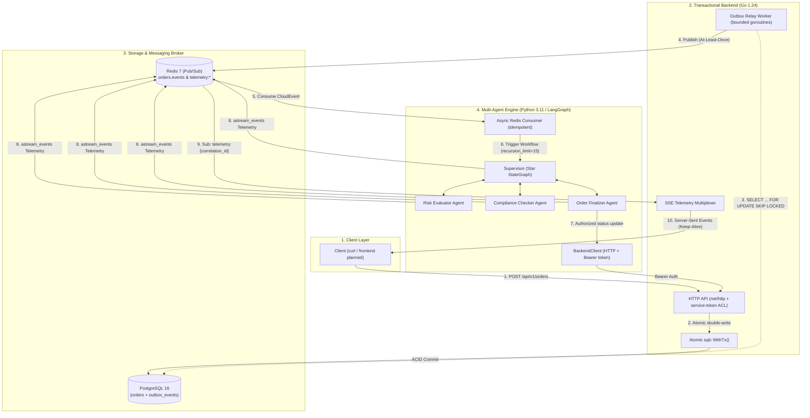

# Transactional Outbox + Multi-Agent Engine (Go, PostgreSQL, LangGraph)

[](backend/go.mod)
[](agent-engine/pyproject.toml)
[](docs/adr/0001-hybrid-multiagent-outbox-architecture.md)
[](backend/internal/middleware/auth.go)

An event-driven prototype that separates a deterministic transactional core (**Go + PostgreSQL**) from an iterative multi-agent workflow (**Python + LangGraph**). Orders and their events are written in the same PostgreSQL transaction (transactional outbox); a relay publishes pending events to Redis Pub/Sub using `SELECT ... FOR UPDATE SKIP LOCKED`; a LangGraph supervisor routes each order through risk, compliance and finalization agents; and progress is streamed to clients over Server-Sent Events (SSE). Agents can only change data through the Go API, authenticated with a service token.

> **Scope:** personal learning project with synthetic data; it is not used in production and the Terraform has not been applied to a real AWS account.
> - **Implemented:** Go API (order creation, status update, SSE telemetry endpoint), sqlc repositories, atomic order + outbox write, relay worker with `SKIP LOCKED` and at-least-once publishing to Redis, constant-time service-token middleware, LangGraph supervisor (star topology) with `recursion_limit=15` and `astream_events` telemetry, Redis consumer with idempotency keys, regex prompt-injection sanitizer, LLM-as-a-judge evaluator, Go unit tests and Python tests, multi-stage non-root Dockerfiles, Docker Compose, a GitHub Actions workflow (lint, tests, Trivy), Terraform for VPC/EKS/RDS/ElastiCache/IRSA, and one ADR.
> - **Simulated / simplified:** the risk and compliance agents return deterministic results; the supervisor uses an OpenAI model with structured output only when `OPENAI_API_KEY` is set and otherwise falls back to deterministic routing; the LLM judge also has a heuristic fallback.
> - **Planned:** a frontend client, model-based risk scoring, and Secrets Manager rotation. The CI workflow is being stabilized (linter and Python packaging steps).

---

## 🏛️ Architectural Topology



---

## 🎯 The 5 Core Architectural Pillars

### 1. Persistence Decoupling & Transactional Outbox Pattern
- **Avoiding Dual-Write Inconsistencies:** The row in `orders` and the event in `outbox_events` are written in the **same PostgreSQL transaction** via [`WithTx()`](backend/internal/service/order_service.go).
- **Non-Blocking Polling:** The [`RelayWorker`](backend/internal/worker/relay_worker.go) fetches pending records with `SELECT ... FOR UPDATE SKIP LOCKED`, backed by the partial index `idx_outbox_events_pending_polling`, so several relay replicas can run without picking the same event.
- **At-Least-Once Delivery:** Publishes to Redis Pub/Sub concurrently through a bounded semaphore and records the outcome (`PUBLISHED`/`FAILED`) in the same database transaction. Consumers must be idempotent, which the Python consumer handles with Redis keys.
- **Graceful Shutdown:** Context-driven shutdown on `SIGTERM` and `SIGINT`.

### 2. Multi-Agent Engine with Star Topology (LangGraph)
- **Central Supervisor:** The [`SupervisorGraph`](agent-engine/src/graph/supervisor.py) routes to specialist agents defined in [`nodes.py`](agent-engine/src/graph/nodes.py): `risk_evaluator`, `compliance_checker` and `order_finalizer`; each returns control to the supervisor.
- **Structured Output Routing:** The next node is chosen through a typed Pydantic model ([`RouterDecision`](agent-engine/src/state/agent_state.py)) when an LLM is configured, with a deterministic fallback for offline or degraded operation.
- **Append-Only State:** The [`AgentState`](agent-engine/src/state/agent_state.py) uses reducer operators (`add_messages`, `operator.add`) so messages and the audit trail are appended rather than overwritten.
- **Loop Safeguard:** Graph invocations set an explicit `recursion_limit=15` to stop runaway cycles.

### 3. Real-Time Telemetry Streaming (SSE + Redis)
- **Streaming via `astream_events`:** The Python engine forwards LangGraph lifecycle events and agent milestones to Redis Pub/Sub on `telemetry:{correlation_id}` channels.
- **Go SSE Multiplexer:** The [`SSETelemetryHandler`](backend/internal/handler/sse_handler.go) relays the Redis channel to clients as a `text/event-stream`.
- **Keep-Alive & Cleanup:** A 15-second heartbeat (`: ping\n\n`) keeps proxies from closing idle connections, and the subscription is closed when the client disconnects.

### 4. Service Authentication & Storage Isolation
- **Storage Isolation:** The Python runtime has no database drivers and no database connection string.
- **Access Control:** Agents change business data only through the Go HTTP API via [`BackendClient`](agent-engine/src/clients/backend_client.py), protected by [`ServiceAuthMiddleware`](backend/internal/middleware/auth.go) with constant-time token comparison (`subtle.ConstantTimeCompare`). This is a shared service token; mTLS or workload identity would be the next step.
- **Prompt Injection Defense:** Input text passes through regex-based guardrails ([`sanitize_text`](agent-engine/src/security/sanitizer.py)) before reaching the supervisor.
- **Secret Management:** No tokens in source code; secrets come from environment variables locally, and the Terraform creates AWS Secrets Manager secrets with IRSA read access.

### 5. DevSecOps & Reliability
- **Non-Root Multi-Stage Containers:**
  - Go is built statically (`CGO_ENABLED=0`, `-ldflags="-w -s"`) into `scratch` images running as `USER 10001:10001`.
  - Python runs as a non-root user with `dumb-init` as PID 1 for signal forwarding.
- **Testing:**
  - Go unit tests with the race detector (`go test -race`).
  - An integration test using [Testcontainers](backend/internal/service/order_service_integration_test.go) (build tag `integration`).
  - Agent evaluation with an *LLM-as-a-judge* in [`tests/eval/test_llm_judge.py`](agent-engine/tests/eval/test_llm_judge.py).
  - Vulnerability scanning in CI with Trivy.

---

## 📂 Repository Structure

```text
.
├── .github/
│   └── workflows/
│       └── ci.yml                 # CI: linters, -race tests, Docker build, Trivy scan
├── agent-engine/                  # Multi-Agent Engine (Python / LangGraph)
│   ├── Dockerfile                 # Multi-stage, non-root, dumb-init
│   ├── pyproject.toml             # Dependencies: langgraph, langchain, pydantic, redis
│   ├── ruff.toml                  # Linter and Bandit security rules
│   ├── src/
│   │   ├── clients/               # BackendClient (HTTP to Go)
│   │   ├── consumer/              # Redis Pub/Sub consumer with idempotency
│   │   ├── evaluation/            # LLM-as-a-judge evaluator
│   │   ├── graph/                 # SupervisorGraph (star topology) & specialist nodes
│   │   ├── security/              # Prompt injection sanitizer
│   │   ├── state/                 # Append-only AgentState
│   │   └── telemetry/             # Redis Pub/Sub telemetry publisher
│   └── tests/                     # Security, graph topology & LLM judge tests
├── backend/                       # Transactional Backend (Go 1.24)
│   ├── Dockerfile.api             # scratch image for the HTTP API
│   ├── Dockerfile.relay           # scratch image for the Outbox Relay Worker
│   ├── cmd/
│   │   ├── api/                   # Server entrypoint (net/http + SSE)
│   │   └── relay/                 # Outbox Relay Worker entrypoint
│   ├── db/
│   │   ├── migrations/            # SQL DDL migrations (pgcrypto, orders, outbox)
│   │   └── queries/               # sqlc queries (orders & outbox with SKIP LOCKED)
│   ├── internal/
│   │   ├── domain/                # CloudEvents v1.0 envelope
│   │   ├── handler/               # HTTP & SSE Telemetry handlers
│   │   ├── middleware/            # ServiceAuthMiddleware
│   │   ├── repository/            # sqlc generated Go code
│   │   ├── service/               # OrderService with atomic WithTx() persistence
│   │   └── worker/                # Concurrent RelayWorker
│   └── sqlc.yaml                  # sqlc configuration for pgx/v5
├── docs/
│   └── adr/
│       └── 0001-hybrid-multiagent-outbox-architecture.md  # Architecture Decision Record
├── infra/
│   └── terraform/                 # IaC: AWS VPC, EKS, RDS PostgreSQL, ElastiCache Redis, IRSA
├── docker-compose.yml             # Local development orchestration
└── README.md                      # Platform documentation
```

---

## 🚀 Local Quickstart & Development

### Prerequisites
- [Docker Engine & Docker Compose](https://docs.docker.com/get-docker/)
- [Go 1.24+](https://go.dev/dl/)
- [Python 3.11+](https://www.python.org/)

### 1. Environment Configuration
Create a `.env` file in the project root (values below are placeholders):

```bash
OPENAI_API_KEY=your-openai-api-key-here   # optional: without it, deterministic routing is used
SERVICE_AUTH_TOKEN=change-me-local-service-token
```

### 2. Launching Services via Docker Compose
The [`docker-compose.yml`](docker-compose.yml) file starts PostgreSQL 16 (with schema migrations), Redis 7, the Go API, the Outbox Relay Worker and the Python LangGraph agent engine:

```bash
docker compose up --build
```

Endpoints after startup:
- **API Health Check:** `GET http://localhost:8080/healthz`
- **Create Order (Transactional):** `POST http://localhost:8080/api/v1/orders`
- **Telemetry Stream (SSE):** `GET http://localhost:8080/v1/telemetry/stream?correlation_id=<ID>`

---

## 📡 Interface & Messaging Contracts

### 1. Create Transactional Order (POST)
**Endpoint:** `POST /api/v1/orders`

```json
{
  "customer_id": "cust_987654",
  "amount_cents": 25000,
  "currency": "USD",
  "metadata": {
    "channel": "web_checkout",
    "ip_address": "192.168.1.1"
  }
}
```

**Response (`201 Created`):**
```json
{
  "id": "a8f3b23c-5899-4d92-9118-a6b1897e7421",
  "customer_id": "cust_987654",
  "amount_cents": 25000,
  "currency": "USD",
  "status": "CREATED",
  "metadata": {"channel": "web_checkout"},
  "created_at": "2026-10-01T17:00:00Z",
  "updated_at": "2026-10-01T17:00:00Z"
}
```

### 2. CloudEvents v1.0 Envelope on Redis
The event recorded in `outbox_events` (in the same transaction as the order) and published to `orders.events`:

```json
{
  "specversion": "1.0",
  "id": "evt_01HZX8B5C0Y3J1234567890ABC",
  "source": "backend.orders.service",
  "type": "order.created.v1",
  "datacontenttype": "application/json",
  "time": "2026-10-01T17:00:00Z",
  "correlation_id": "corr_9876543210",
  "causation_id": "cmd_1234567890",
  "data": {
    "order_id": "a8f3b23c-5899-4d92-9118-a6b1897e7421",
    "customer_id": "cust_987654",
    "amount_cents": 25000,
    "currency": "USD",
    "status": "CREATED"
  }
}
```

### 3. Real-Time SSE Telemetry Stream
**Client Connection:** `GET /v1/telemetry/stream?correlation_id=corr_9876543210`

```text
event: connected
data: {"status":"STREAM_ESTABLISHED","correlation_id":"corr_9876543210"}

: ping

event: telemetry_event
data: {"event_type":"LANGGRAPH_ON_CHAIN_START","correlation_id":"corr_9876543210","timestamp":"2026-10-01T17:00:01Z","data":{"node":"supervisor"}}

event: telemetry_event
data: {"event_type":"RISK_EVALUATION_COMPLETED","correlation_id":"corr_9876543210","timestamp":"2026-10-01T17:00:02Z","data":{"order_id":"a8f3b23c-...","assessment":{"risk_level":"LOW","score":0.15}}}

event: telemetry_event
data: {"event_type":"COMPLIANCE_CHECK_COMPLETED","correlation_id":"corr_9876543210","timestamp":"2026-10-01T17:00:03Z","data":{"order_id":"a8f3b23c-...","check":{"is_compliant":true}}}

event: telemetry_event
data: {"event_type":"ORDER_MUTATION_COMPLETED","correlation_id":"corr_9876543210","timestamp":"2026-10-01T17:00:04Z","data":{"order_id":"a8f3b23c-...","final_status":"APPROVED"}}
```

---

## 🧪 Testing & Validation Strategy

### Go Unit Tests (with Race Detector)
```bash
cd backend
go test -v -race ./...
```

### Transactional Integration Tests with Testcontainers
Checks the atomic order + outbox write against an ephemeral PostgreSQL container (requires Docker; the Testcontainers module may need to be added with `go get` first):
```bash
cd backend
go test -v -tags=integration ./...
```

### Multi-Agent Engine Tests & Linters (Python)
```bash
cd agent-engine
# Lint, formatting and security rules
ruff check .
ruff format --check .

# Structural and prompt injection tests
pytest -v tests/unit/

# LLM-as-a-judge evaluation (uses the heuristic fallback without OPENAI_API_KEY)
pytest -v tests/eval/
```

---

## 🔒 Cloud Infrastructure (AWS / Terraform)

The [`infra/terraform`](infra/terraform) directory contains the infrastructure-as-code (written for learning; not applied to a live account):
- **Networking:** VPC with public, private compute and isolated database subnets ([`vpc.tf`](infra/terraform/vpc.tf)).
- **Compute:** AWS EKS cluster and node group ([`eks.tf`](infra/terraform/eks.tf)) with IAM Roles for Service Accounts ([`irsa.tf`](infra/terraform/irsa.tf)).
- **Persistence:** AWS RDS PostgreSQL with storage encryption, Multi-AZ in the `prod` environment, and generated credentials stored in Secrets Manager ([`rds.tf`](infra/terraform/rds.tf)).
- **Broker & Cache:** Multi-AZ AWS ElastiCache Redis with in-transit TLS and an auth token in Secrets Manager ([`elasticache.tf`](infra/terraform/elasticache.tf)).

---

## 📖 Key Documentation References
- [ADR-0001: Hybrid Transactional & Multi-Agent Architecture](docs/adr/0001-hybrid-multiagent-outbox-architecture.md)
- [PostgreSQL DDL Migrations](backend/db/migrations/000001_init_schema.up.sql)
- [GitHub Actions CI/CD Pipeline](.github/workflows/ci.yml)
