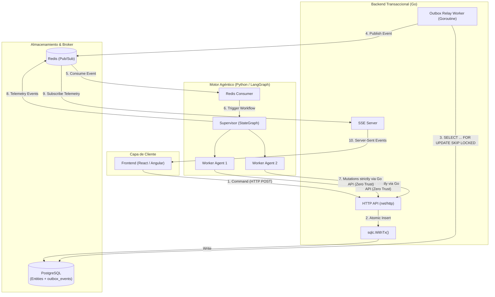
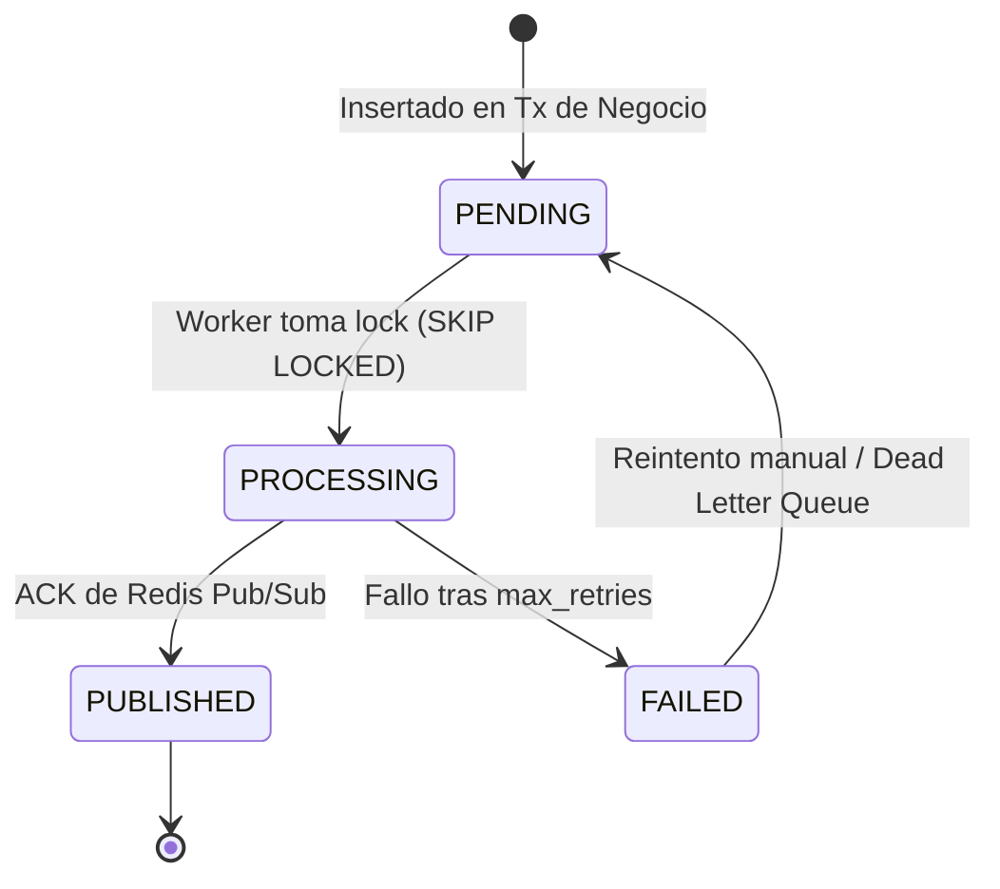

# ADR-0001: Arquitectura Híbrida Backend Transaccional y Motor Multiagente Orientado a Eventos

- **Estado:** Aceptado
- **Fecha:** 2026-10-01
- **Autor:** Principal System Engineer
- **Decisores:** Equipo de Arquitectura y Plataforma

---

## 1. Contexto y Problemática

La plataforma requiere integrar dos paradigmas computacionales con características operativas divergentes:
1. **Flujos transaccionales deterministas de alto rendimiento:** Gestión de usuarios, cobros, auditoría y persistencia de entidades de negocio donde la integridad de datos (ACID), la baja latencia y el control estricto de concurrencia son mandatorios.
2. **Flujos no deterministas de Inteligencia Artificial agéntica:** Orquestación de agentes especializados mediante Large Language Models (LLMs) ejecutando razonamiento iterativo, llamadas a herramientas (*tools*) y toma de decisiones dinámicas con tiempos de ejecución que varían de segundos a minutos.

### Riesgos y Restricciones
- **Acoplamiento sincrónico:** Exponer llamadas directas HTTP o gRPC desde el backend transaccional a los agentes bloquea threads de ejecución, agota connection pools y traslada la inestabilidad de latencia de los LLMs al núcleo del negocio.
- **Inconsistencia de doble escritura (Dual-Write Problem):** Actualizar la base de datos y publicar un evento en el message broker de forma independiente puede generar estados inconsistentes ante caídas del proceso de red.
- **Riesgos de Seguridad (Zero Trust):** Otorgar credenciales de acceso directo a la base de datos relacional a modelos de lenguaje o entornos de ejecución de agentes incrementa la superficie de ataque ante vectores de *Prompt Injection* y exfiltración de datos.

---

## 2. Decisión Arquitectónica

Se adopta una **Arquitectura Híbrida Desacoplada Orientada a Eventos (EDA)** basada en los siguientes componentes fundamentales:



### 2.1. Desacoplamiento de Persistencia: Patrón Outbox Transaccional
- **Doble escritura atómica:** Las mutaciones de estado de negocio se persisten en la misma transacción ACID de PostgreSQL que el registro del evento en la tabla `outbox_events` mediante `sqlc.WithTx()`.
- **Garantía At-Least-Once:** Un worker asíncrono en Go desacoplado consulta eventos no publicados utilizando `SELECT ... FOR UPDATE SKIP LOCKED` para evitar contención de bloqueos entre réplicas del worker, publica hacia Redis Pub/Sub y marca el registro como `PUBLISHED`.

#### Máquina de Estados del Evento Outbox


### 2.2. Contrato Estándar de Mensajería (Envelope CloudEvents)
Todos los eventos transmitidos a través de Redis deben cumplir una estructura inmutable y versionada:

```json
{
  "specversion": "1.0",
  "id": "evt_01HZX8B5C0Y3J1234567890ABC",
  "source": "backend.transactional.orders",
  "type": "order.created.v1",
  "datacontenttype": "application/json",
  "time": "2026-10-01T14:10:00Z",
  "correlation_id": "corr_9876543210",
  "causation_id": "cmd_1234567890",
  "data": {
    "order_id": "ord_1001",
    "customer_id": "cust_500",
    "amount_cents": 15000,
    "currency": "USD"
  }
}
```

### 2.3. Topología del Motor Agéntico: Supervisor en LangGraph
- **Estructura en Estrella:** Un nodo central `Supervisor` gestiona la asignación de tareas a agentes especialistas subordinados.
- **Enrutamiento Estructurado:** El Supervisor utiliza `Structured Output` (vía Pydantic/Instructor) para emitir decisiones deterministas sobre qué nodo debe procesar el estado.
- **Inmutabilidad de Estado:** `AgentState` opera bajo el principio *append-only* (usando anotaciones `Annotated[list, add]` en LangGraph).
- **Límites de Recursión:** Cada compilación e invocación del grafo define explícitamente `recursion_limit` (evitando bucles infinitos no controlados).

### 2.4. Telemetría en Tiempo Real (Server-Sent Events)
- El frontend establece una conexión SSE unidireccional con el backend de Go (`/v1/telemetry/stream?correlation_id=...`).
- El backend en Go actúa como multiplexor: se suscribe a los canales de telemetría de Redis emitidos por los agentes de LangGraph y los transmite al cliente HTTP con control de ciclo de vida atado a `r.Context().Done()`.

### 2.5. Modelo de Seguridad Zero Trust
1. **Aislamiento de Almacenamiento:** El entorno de ejecución en Python carece deliberadamente de variables de conexión o drivers para PostgreSQL.
2. **Acceso a Datos Mediante API de Go:** Si un agente requiere leer o alterar una entidad de negocio, debe realizar una petición HTTPS firmada contra endpoints expuestos por Go con credenciales de servicio (Service-to-Service OIDC/mTLS) y scopes de autorización específicos.
3. **Barrera de Sanitización y Guardrails:**
   - Go valida esquemas y pre-procesa el texto entrante contra vectores comunes de inyección.
   - La entrada a LangGraph atraviesa un nodo interceptor de validación sintáctica y semántica antes del nodo Supervisor.
4. **Gestión de Secretos:** Integración con AWS Secrets Manager y Kubernetes Secrets montados vía CSI driver; queda prohibido almacenar secretos en repositorios o variables de entorno en texto plano.

---

## 3. Consecuencias

### 3.1. Positivas
- **Resiliencia y Consistencia:** Se elimina el problema de doble escritura. Si el broker (Redis) experimenta una interrupción temporal, los eventos quedan retenidos de forma segura en PostgreSQL y se enviarán automáticamente una vez restablecida la conectividad.
- **Separación de Responsabilidades y Escalabilidad:** El backend transaccional en Go escala horizontalmente según la carga de I/O de red, mientras que los workers de LangGraph escalan de forma independiente según el consumo de compute/tokens de los LLMs.
- **Trazabilidad y Auditoría:** La tabla `outbox_events` proporciona un log de auditoría inmutable de todas las mutaciones que desencadenaron flujos agénticos.
- **Reducción de Superficie de Ataque:** Incluso si un agente sufre un *jailbreak* o *prompt injection*, está limitado estrictamente a las herramientas HTTP autorizadas del API de Go y no puede ejecutar sentencias SQL arbitrarias.

### 3.2. Negativas y Mitigaciones
- **Consistencia Eventual:** La interfaz de usuario experimenta una latencia de propagación entre el guardado de la entidad y la respuesta del agente.
  - *Mitigación:* Se implementa SSE para proveer feedback inmediato de progreso y estado ("pensando", "procesando herramienta X", etc.).
- **Entrega "At-Least-Once" (Duplicidad potencial):** Si un worker publica a Redis pero falla antes de actualizar el estado en Postgres, el evento podría publicarse nuevamente.
  - *Mitigación:* Los consumidores en LangGraph y los endpoints de mutación en Go deben ser idempotentes, deduplicando por `event_id` y `correlation_id`.
- **Sobrecarga de Almacenamiento en Outbox:** La tabla `outbox_events` puede crecer rápidamente en volumen.
  - *Mitigación:* Se implementará una estrategia de retención/particionamiento y purga periódica para registros en estado `PUBLISHED` con más de $N$ días.

---

## 4. Estado de Cumplimiento y Próximos Pasos

Este documento establece la base sobre la cual se validará todo Pull Request y diseño posterior. Los componentes directos a implementar a continuación son:
1. Esquema DDL en PostgreSQL para `outbox_events` y configuración de `sqlc.yaml`.
2. Estructura base del módulo Go (`net/http`, transacciones con `sqlc`, Relay Worker).
3. Estructura base del módulo Python (`AgentState`, supervisor con structured outputs, client HTTP hacia Go).
